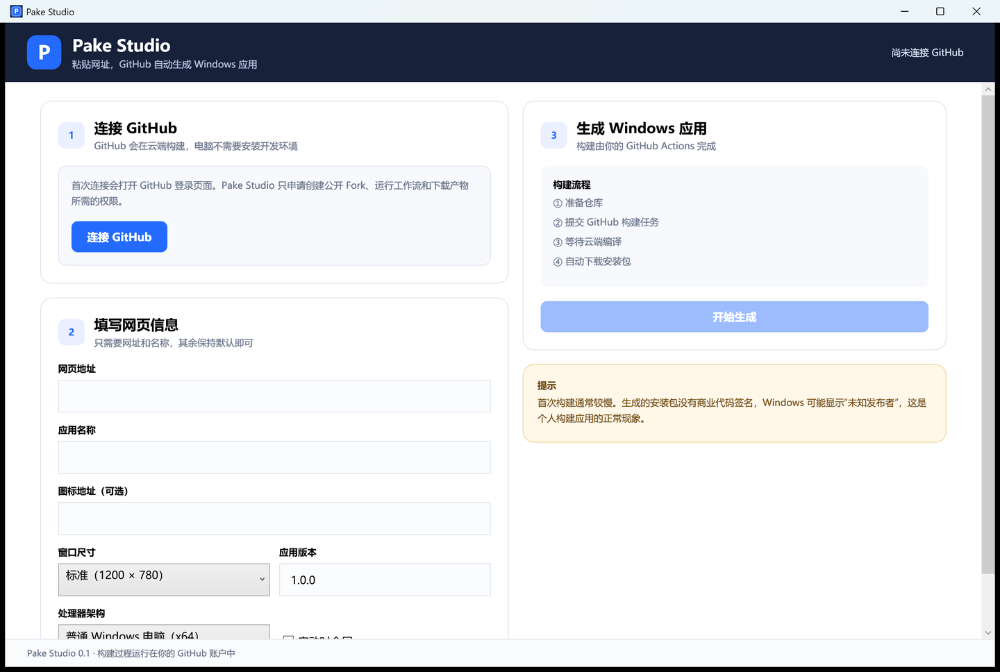

# Pake Studio for Windows

Pake Studio 是一个面向普通用户的 Windows 图形化客户端：

1. 连接 GitHub。
2. 粘贴网页地址。
3. 填写应用名称。
4. 点击“开始生成”。
5. 等待 GitHub Actions 完成构建。
6. 自动下载包含 MSI 安装程序的 ZIP。

终端用户不需要安装 Node.js、Rust、Visual Studio 或 Pake CLI。所有构建均运行在用户自己的 GitHub 账户和 Pake Fork 中。



## 当前版本

这是 `0.1.0` MVP，已经包含：

- GitHub OAuth Device Flow 登录
- GitHub Token 开发模式回退
- Windows Credential Manager 安全保存令牌
- 自动创建 `tw93/Pake` Fork
- 自动启用 `pake-cli.yaml` 工作流
- 图形化填写网址、名称、图标、尺寸和版本
- 触发 Windows GitHub Actions 构建
- 实时轮询队列与构建状态
- 自动下载 GitHub Artifact
- 取消构建和打开 GitHub 日志

## 为发布版本配置 GitHub 登录

Pake Studio 使用 GitHub OAuth App 的 Device Flow。仓库维护者只需要配置一次：

1. 在 GitHub Developer Settings 中创建 OAuth App。
2. Homepage URL 填写本项目仓库地址。
3. Authorization callback URL 可填写 `http://127.0.0.1`。
4. 在 OAuth App 设置中启用 Device Flow。
5. 在本仓库的 `Settings → Secrets and variables → Actions → Variables` 中创建：

   ```text
   PAKE_STUDIO_GITHUB_CLIENT_ID
   ```

6. 值填写 OAuth App 的 Client ID。
7. 运行 `Build Pake Studio for Windows` 工作流。

GitHub Actions 会把 Client ID 写入发布的 EXE。Device Flow 不需要在客户端内保存 OAuth Client Secret。

如果没有配置 Client ID，开发构建会显示 GitHub Token 回退入口。

> 当前 OAuth App 使用 `read:user public_repo workflow` 范围。GitHub OAuth App
> 不支持只授权到某一个公开仓库，因此发布者应在隐私说明中明确展示这一点。
> 后续可以迁移到 GitHub App 安装授权，进一步缩小仓库权限范围。

## 本地开发

要求：

- Windows 10/11
- .NET 10 SDK

```powershell
dotnet build PakeStudio.csproj -c Release
dotnet run --project PakeStudio.csproj
```

本地测试 OAuth Client ID：

```powershell
$env:PAKE_STUDIO_GITHUB_CLIENT_ID="你的 Client ID"
dotnet run --project PakeStudio.csproj
```

## 发布

推送到 `main` 或手动运行 GitHub Actions，会生成：

```text
Pake-Studio-Windows-x64/PakeStudio.exe
```

推送 `v*` 标签会同时创建 GitHub Release。

## 安全说明

- GitHub Token 使用 Windows Credential Manager 保存。
- Pake Studio 不接收用户的网页源码或账号信息。
- 构建任务运行在用户自己的 GitHub Fork。
- 构建产物直接从 GitHub 下载。
- 普通用户生成的 MSI 没有商业代码签名，Windows 可能显示“未知发布者”。

## 与 Pake 的关系

Pake Studio 不包含或修改 Pake 源代码，而是调用用户自己 Fork 中公开的 GitHub Actions 工作流。Pake 由 Tw93 和社区维护，本项目是独立的图形化客户端。
